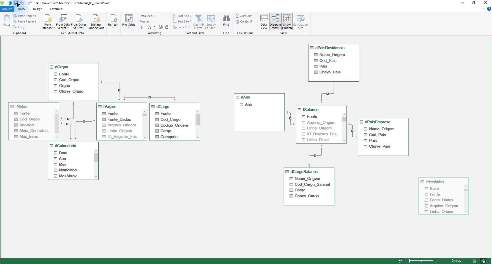

# Modelo relacional — TechTalent

Origem: `MA2026-entrega-parcial/02-powerquery/TechTalent_02_PowerQuery.xlsx`, definida por `pArquivoEtapa2`. As tabelas são lidas por nome, com `Kind = Table`; os dados e cadastros mantêm sua origem na Etapa 2.

## Tabelas e grãos

| Tabela | Papel e grão | Chave | Linhas de referência |
| --- | --- | --- | ---: |
| `fVagas` | Fato: evento de publicação aceito. | Rastreio único `ID_Registro_FaseI`; FKs de cargo, órgão e data. | 232 |
| `fMetas` | Fato: empresa simulada em um mês. | `Fonte + Cod_Orgao + AnoMes`; FKs de órgão e mês. | 12 |
| `fSalarios` | Fato: observação salarial histórica. | Rastreio único `ID_Registro_FaseI`; FKs de cargo, países e ano. | 6.599 |
| `dCargo` | Dimensão: cargo público NYC ou cargo fictício. | `Cod_Cargo`. | 45 |
| `dOrgao` | Dimensão: órgão NYC ou empresa fictícia. | `Cod_Orgao`. | 31 |
| `dCalendario` | Dimensão: dia de 01/01 a 31/12/2026. | `Data`. | 365 |
| `dCargoSalarios` | Dimensão: cargo da fonte salarial. | `Cod_Cargo_Salarial`. | 132 |
| `dPaisEmpresa` | Dimensão de papel: país da empresa. | `Cod_Pais`. | 89 |
| `dPaisResidencia` | Dimensão de papel: país da residência. | `Cod_Pais`. | 89 |
| `dAno` | Dimensão: ano da observação salarial. | `Ano`. | 5 |
| `Rejeitados` | Auditoria: registro descartado com primeiro motivo. | Linhagem da Etapa 2; sem relação. | 8 |

`fVagas` preserva os 36 campos e `fSalarios`, os 21 campos da entrada. `ID_Vaga` não é chave única de publicação: tipo, data e horário podem distinguir eventos legítimos. Os dois casos `SIM-001` permanecem. Salários iguais não são tratados como registros duplicados.

## Relacionamentos

Todos são **ativos, N:1 e com filtro da dimensão para a fato**. Os fatos compartilham dimensões, sem relação direta entre si.

| Lado N — FK | Lado 1 — PK |
| --- | --- |
| `fVagas[Cod_Cargo]` | `dCargo[Cod_Cargo]` |
| `fVagas[Cod_Orgao]` | `dOrgao[Cod_Orgao]` |
| `fVagas[Data_Publicacao]` | `dCalendario[Data]` |
| `fMetas[Cod_Orgao]` | `dOrgao[Cod_Orgao]` |
| `fMetas[Mes_Inicio]` | `dCalendario[Data]` |
| `fSalarios[Cod_Cargo_Salarial]` | `dCargoSalarios[Cod_Cargo_Salarial]` |
| `fSalarios[Cod_Pais_Empresa]` | `dPaisEmpresa[Cod_Pais]` |
| `fSalarios[Cod_Pais_Residencia]` | `dPaisResidencia[Cod_Pais]` |
| `fSalarios[Ano]` | `dAno[Ano]` |

Os dois papéis de país referenciam o mesmo cadastro `dPais` da Etapa 2. As taxonomias de cargos das vagas e dos salários não possuem correspondência validada entre si. `Cod_Orgao` NYC é uma chave técnica derivada da agência informada; `Cod_Cargo` aproveita `title_code_no` com prefixo de fonte.

## Calendário e apresentação

`dCalendario` contém `Data`, `Ano`, `Mes`, `NomeMes`, `MesAbrev`, `AnoMes`, `Mes_Inicio`, `Trimestre`, `DiaSemana`, `NomeDia`, `FimDeSemana` e `Feriado`. Os dias são contínuos; a semana começa na segunda-feira. `Feriado = Não informado` evita aplicar um calendário brasileiro aos anúncios NYC.

No Power Pivot, `dCalendario` está marcada como Tabela de Datas pela coluna `Data`; `NomeMes` e `MesAbrev` são classificados por `Mes`, e `NomeDia`, por `DiaSemana`. As metas se ligam ao dia 1 de cada mês; em análise diária, a meta inteira aparece nesse dia. A comparação deve usar mês, trimestre ou ano.

As chaves das fatos, os campos de linhagem, os cálculos auxiliares de faixa e `Mes_Inicio` do calendário estão ocultos das Ferramentas Cliente. `fMetas` e `Rejeitados` também ficam ocultas; as metas são consumidas pelas medidas. Quantidades e limites salariais permanecem visíveis para conferência.

## Medidas e unidades

O [catálogo DAX](../dax/medidas_preliminares.dax) contém as definições e formatos. `SUMX` mede posições por publicação; `DISTINCTCOUNT` distingue IDs por fonte; `DIVIDE` calcula razões; `RELATED` recupera a referência didática de cargo. Essa referência exige fonte SIMULADO, BRL/mês, unidade coincidente e valor positivo; não é custo realizado.

Metas são contratações planejadas fictícias. A razão com posições anunciadas é um exercício comparativo, sem afirmar contratação realizada. A média USD usa somente a fonte salarial histórica, com periodicidade não confirmada. Não há conversão cambial ou agregação entre moedas.

## Integridade, reconciliação e linhagem

As medidas `Conf` cobrem contagens, PK duplicada/vazia, FKs órfãs, continuidade do calendário e reprodução das faixas. `Conferencia` confronta medidas do modelo com referências da Etapa 2; as diferenças estão zeradas.

Para demonstrar a cadeia **Etapa 1 → Etapa 2 → Etapa 3**, use cópias dos três arquivos: altere a referência SIM-C01 de 10.000 para 10.100 no cadastro da Etapa 1, salve e atualize as etapas seguintes em sequência. A referência comparável deve passar de 48.000 para 48.400, mantendo as contagens; a referência fixa em Conferencia deve mostrar diferença de 400. Restaure 10.000 e repita a atualização para retornar à diferença zero. É a adaptação da conferência de linhagem da p30 do guia, alterando um atributo cadastral em vez de admitir um registro rejeitado.
