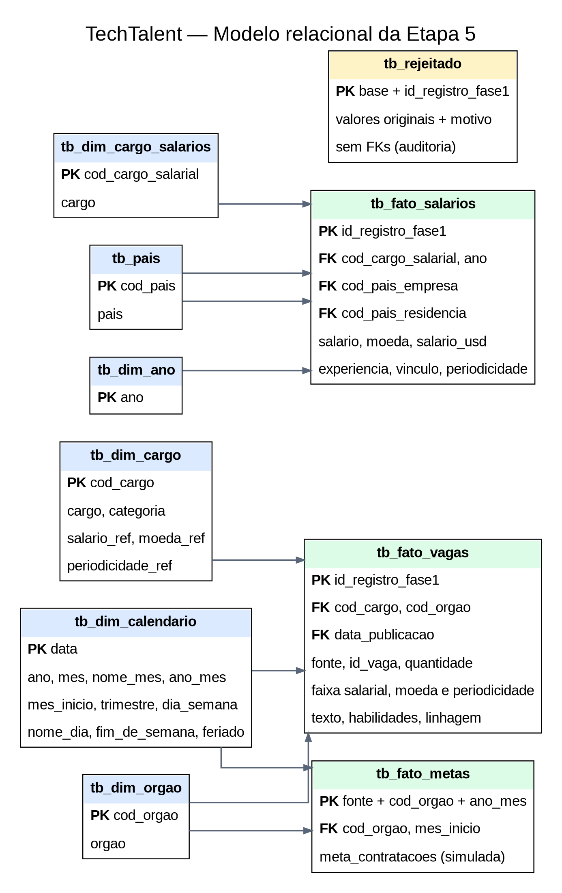
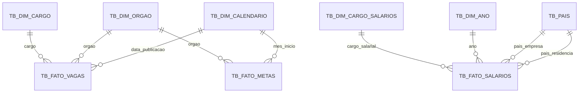

# Modelo relacional — TechTalent

## Origem e escopo

O modelo implementa a estrutura já documentada em `MA2026-entrega-parcial/03-powerpivot/docs/modelo_relacional.md`. As entradas principais são `fVagas` e `fSalarios`, exportadas pela Etapa 2. Também são necessários os cadastros/referências da Etapa 2 (`dCargo`, `fMetas` e `Rejeitados`).

O banco distingue três unidades de negócio que não devem ser somadas como se fossem equivalentes:

1. eventos de publicação de vagas (`fVagas`);
2. observações salariais históricas (`fSalarios`);
3. metas de contratação fictícias (`fMetas`).

## Tabelas e grãos

| Tabela física | Grão | PK | Relações |
|---|---|---|---|
| `tb_fato_vagas` | Um evento de publicação aceito | `id_registro_fase1` | cargo, órgão e data |
| `tb_fato_salarios` | Uma observação salarial histórica | `id_registro_fase1` | cargo salarial, país da empresa, país de residência e ano |
| `tb_fato_metas` | Uma empresa simulada em um mês | `(fonte, cod_orgao, ano_mes)` | órgão e primeiro dia do mês |
| `tb_dim_cargo` | Um cargo de publicação | `cod_cargo` | referenciada por `tb_fato_vagas` |
| `tb_dim_orgao` | Um órgão/empresa | `cod_orgao` | referenciada por `tb_fato_vagas` e `tb_fato_metas` |
| `tb_dim_calendario` | Um dia de 2026 | `data` | referenciada por vagas e metas |
| `tb_dim_cargo_salarios` | Um cargo da fonte salarial | `cod_cargo_salarial` | referenciada por `tb_fato_salarios` |
| `tb_pais` | Um país | `cod_pais` | dois papéis FKs em `tb_fato_salarios` |
| `tb_dim_ano` | Um ano salarial | `ano` | referenciada por `tb_fato_salarios` |
| `tb_rejeitado` | Um registro rejeitado por base | `(base, id_registro_fase1)` | isolada intencionalmente, sem FKs |

As tabelas `stg_*` são áreas de recebimento e não fazem parte do modelo analítico final.

## Relacionamentos

Todos os relacionamentos são N:1 das fatos para as dimensões. Não há relação direta entre `tb_fato_vagas` e `tb_fato_salarios`.

## Views para a camada analítica

| View | Tabela física | Papel |
|---|---|---|
| `dim_cargo` | `tb_dim_cargo` | Cargo das publicações e referência salarial dos casos simulados |
| `dim_orgao` | `tb_dim_orgao` | Órgãos NYC e empresas fictícias |
| `dim_tempo` | `tb_dim_calendario` | Calendário contínuo de 2026 |
| `dim_cargo_salarios` | `tb_dim_cargo_salarios` | Taxonomia de cargos da fonte salarial |
| `dim_pais_empresa` | `tb_pais` | País onde a empresa está localizada |
| `dim_pais_residencia` | `tb_pais` | País de residência |
| `dim_ano` | `tb_dim_ano` | Ano da observação salarial |
| `fato_vagas` | `tb_fato_vagas` | Eventos de publicação, preservando os 36 campos originais |
| `fato_salarios` | `tb_fato_salarios` | Observações salariais, preservando os 21 campos originais |
| `fato_metas` | `tb_fato_metas` | Planejamento fictício por empresa/mês |

As views usam os nomes dos campos da Etapa 3 sempre que possível, facilitando a conferência e a futura conexão do Power BI.

## Regras de integridade

- `ID_Registro_FaseI` identifica uma linha tratada e é a chave primária das duas fatos de observações.
- `ID_Vaga` não é único. Publicações internas e externas podem compartilhar o mesmo identificador.
- `Quantidade` precisa ser um inteiro positivo nas vagas aceitas.
- `Data_Publicacao` precisa estar no calendário contínuo de 2026.
- Limites salariais negativos são recusados; quando ambos existem, o limite máximo não pode ser menor que o mínimo.
- As observações salariais preservam moeda e periodicidade informadas. Não se presume periodicidade para a base histórica.
- O campo `Fonte` das metas precisa ser `SIMULADO`; `Meta_Contratacoes` não significa contratação realizada.
- `tb_rejeitado` não tem FKs de propósito: registros rejeitados podem conter justamente códigos, datas ou quantidades inválidas. Os campos de origem ficam como texto para não alterar os valores recusados.

## Decisões de modelagem

### Cargos

`tb_dim_cargo` e `tb_dim_cargo_salarios` permanecem separadas porque a documentação da Etapa 3 não estabelece correspondência validada entre as taxonomias. Não foi criada uma relação artificial entre elas.

### Países

A Etapa 3 usa duas dimensões de papel derivadas do mesmo cadastro de países. No banco relacional, `tb_pais` evita duplicar o cadastro físico; as FKs de empresa e residência apontam para a mesma PK. As views `dim_pais_empresa` e `dim_pais_residencia` mantêm os dois papéis separados para análise.

### Datas

Apenas vagas e metas usam o calendário de 2026. Os salários históricos possuem apenas o ano (2020–2024), portanto relacionam-se a `tb_dim_ano`, sem criação de datas diárias fictícias.

### Habilidades

`Habilidades` permanece como texto original na fato de vagas. O projeto ainda não documenta uma tabela normalizada de competências nem regras aprovadas para extrair termos das descrições. A consulta C2 usa pesquisa textual exploratória e explicita essa limitação.

## Quantidades de referência

As referências publicadas nas Etapas 2 e 3 são: 232 vagas aceitas, 260 posições reportadas, 122 IDs distintos por fonte, 6.599 observações salariais, 12 metas (soma 31), 8 rejeitados, 45 cargos de vagas, 31 órgãos/empresas, 132 cargos salariais, 89 países, 5 anos e 365 dias de calendário.
